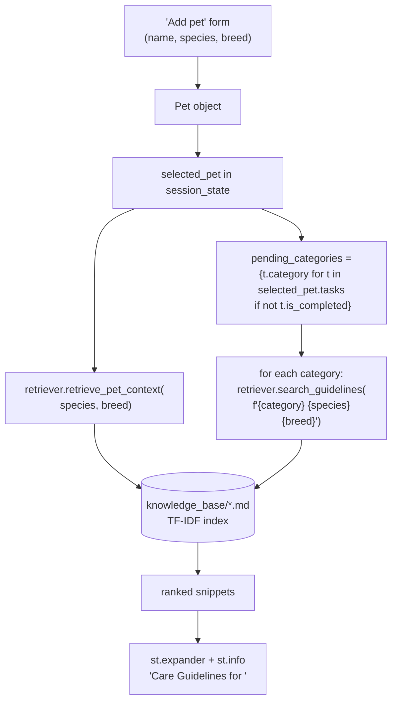
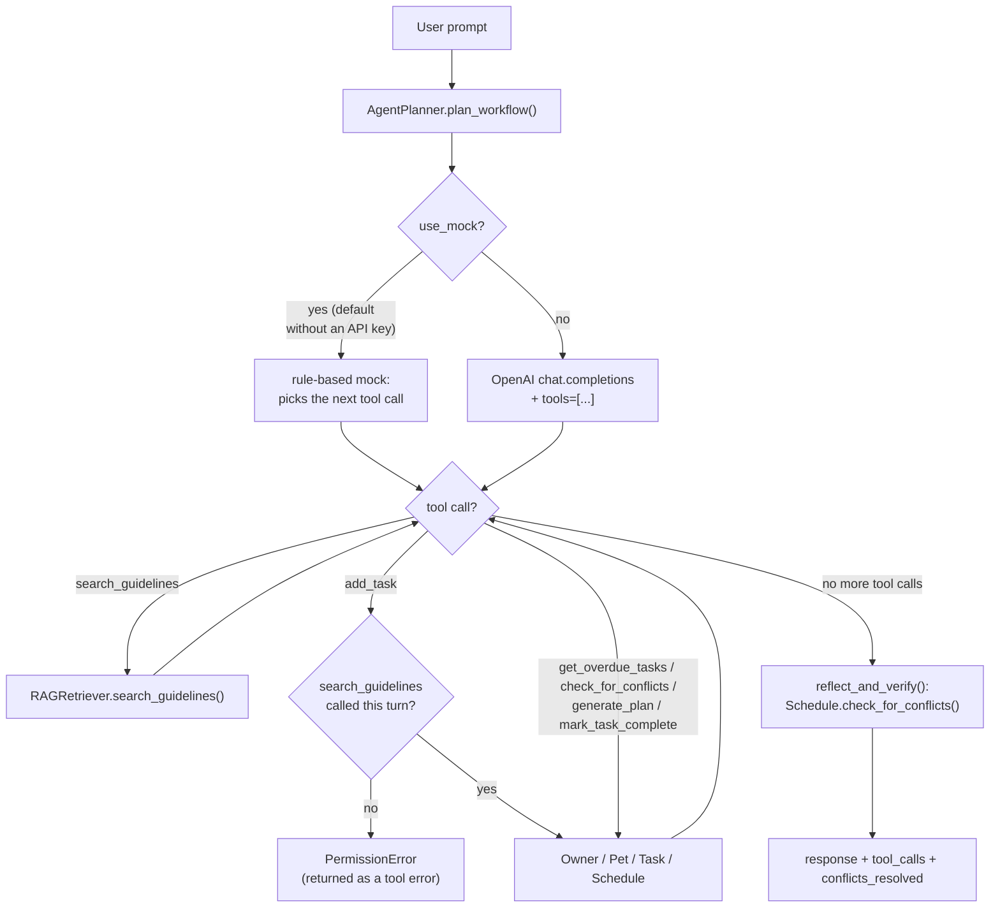

# PawPal+ Architecture

This is the up-to-date architecture reference for PawPal+. `README.md` covers
setup and sample interactions; this document covers how the pieces actually
fit together, including the Retrieval-Augmented Generation (RAG) pipeline and
its integration into the Streamlit UI. The component class diagram lives
separately at [`diagrams/architecture.mmd`](diagrams/architecture.mmd) and is
unchanged by this update -- its `Owner`/`Pet`/`Task`/`Schedule`/
`RAGRetriever`/`AgentPlanner` classes and relationships already match the
implementation described below.

## 1. Layers

PawPal+ is a hybrid system with four layers. Each layer only calls into the
one below it -- nothing above the deterministic core reimplements its math.

| Layer | Module | Responsibility |
|---|---|---|
| Presentation | `app.py` (Streamlit), `main.py` / `agent_main.py` (CLI demos) | User-facing dashboard and CLI entry points |
| Agentic planning | `src/planner.py` -- `AgentPlanner` | Translates natural language into calls against the tools below |
| Retrieval (RAG) | `src/rag.py` -- `RAGRetriever` | Local, offline search over `knowledge_base/` |
| Deterministic core | `pawpal_system.py` -- `Owner`, `Pet`, `Task`, `Schedule` | All scheduling math: sorting, recurrence, conflict detection |

The deterministic core has no dependency on either `RAGRetriever` or
`AgentPlanner` and is covered by its own test file (`tests/test_pawpal.py`).
Nothing in this update touched `pawpal_system.py`.

## 2. RAGRetriever: local, offline retrieval

`RAGRetriever` (`src/rag.py`) loads every `.md`/`.txt` file under
`knowledge_base/` (feeding guidelines, breed notes, general care), splits
each one into chunks at Markdown headings, and ranks chunks against a query
with a small pure-Python TF-IDF cosine-similarity index. It has **no
external dependencies and makes no network calls** -- it's as offline as
`pawpal_system.py` itself. It's used in two places:

1. **Directly from the Streamlit UI** (`app.py`) -- an always-on "Care
   Guidelines" panel, described in section 3.
2. **As a tool inside `AgentPlanner`'s tool-use loop** (`search_guidelines`)
   -- the grounding step that `add_task` cannot skip (see section 4).

Both call sites share the exact same retriever logic; there is no
UI-specific or agent-specific copy of the retrieval code.

## 3. Streamlit UI integration (`app.py`)

### 3.1 Cached resource

```python
@st.cache_resource
def get_retriever() -> RAGRetriever:
    return RAGRetriever("knowledge_base")

retriever = get_retriever()
```

`@st.cache_resource` means `knowledge_base/` is read from disk and the
TF-IDF index built exactly once per Streamlit process -- not on every widget
interaction/rerun, which is how Streamlit re-executes the whole script top
to bottom on every button click or input change.

### 3.2 Data flow: pet details + active tasks -> contextual care tips



Concretely, in `app.py`:

- The **"Add pet"** form now has a `Breed (optional)` text input (previously
  every pet defaulted to `breed="Unknown"`, which gave the retriever nothing
  breed-specific to match against).
- A **"Care Guidelines for `<pet>`"** section (placed after the task table,
  before "Today's Schedule") renders:
  - One expander with general species/breed guidance, from
    `retriever.retrieve_pet_context(selected_pet.species, selected_pet.breed)`.
  - One expander per distinct category among the pet's *active*
    (incomplete) tasks -- e.g. `walk`, `feeding`, `meds` -- each querying
    `retriever.search_guidelines(f"{category} {species} {breed}", top_k=2)`
    and rendering the returned snippets via `st.info`, or a "no matching
    guidelines" caption when the query matches nothing.

This panel is independent of `AgentPlanner` -- `app.py` does not import or
call the agent at all. It works identically regardless of which
`AgentPlanner` execution mode (section 4) is configured, because
`RAGRetriever` never touches the network either way.

## 4. AgentPlanner: the agentic tool-use loop

`AgentPlanner` (`src/planner.py`) drives a tool-calling loop against the
same deterministic core, with `search_guidelines` as one of its tools:



Key properties, unchanged by the UI work in section 3:

- **Grounding is enforced, not just prompted.** `add_task` raises a
  `PermissionError` (surfaced to the model as a tool error) if
  `search_guidelines` hasn't been called yet in the same turn.
- **The LLM never computes schedule math.** Every tool call dispatches to
  `Owner`/`Pet`/`Task`/`Schedule`'s own public methods; `_execute_tool()`
  contains no sorting, date-offset, or conflict-detection logic of its own.
- **`reflect_and_verify()` is pure Python.** It re-runs
  `Schedule.check_for_conflicts()` after every tool loop -- it never asks
  the LLM to grade its own work.

### 4.1 Execution modes

| Mode | Trigger | Network? | What runs |
|---|---|---|---|
| **Mock (offline)** | `USE_MOCK_LLM=true`, or no `OPENAI_API_KEY` set (**default**) | None | `_run_mock_workflow()`: a small keyword-based stand-in picks which tool to call next, but every tool it picks (`search_guidelines`, `add_task`, ...) still runs for real against `RAGRetriever` and the real `Owner`/`Pet`/`Task`/`Schedule` objects. |
| **OpenAI (cloud)** | `OPENAI_API_KEY` set, `USE_MOCK_LLM` unset/false | Yes (`api.openai.com`) | A real `gpt-4o-mini` (default; override via `PAWPAL_AGENT_MODEL`) tool-calling loop via `client.chat.completions.create(..., tools=[...])`. |

Mock mode only replaces the *reasoning* step (which tool to call next, and
what to say about the results) -- it never bypasses or reimplements a
deterministic tool. This is why mock-mode tests
(`tests/test_planner_mock.py`) can assert on real side effects, like a task
actually being appended to a real `Pet.tasks` list.

## 5. Test coverage

All suites run offline, with no API key required, in well under a second:

| File | Tests | Covers |
|---|---|---|
| `tests/test_pawpal.py` | 28 | Deterministic core: `Owner`, `Pet`, `Task`, `Schedule` -- sorting, filtering, recurrence, conflict detection |
| `tests/test_rag.py` | 5 | `RAGRetriever`: chunking, TF-IDF search, `retrieve_pet_context`, the `search_guidelines` tool schema/handler |
| `tests/test_planner_mock.py` | 6 | `AgentPlanner` in mock mode: tool-call sequencing, the `add_task` grounding guard, `parse_intent`, mode auto-detection |
| **Total** | **39** | `pytest -q` -> `39 passed` |

`pawpal_system.py` was not modified to build the RAG or agentic layers, and
none of the new tests touch it except through its existing public API --
`tests/test_pawpal.py`'s original 28 tests are untouched and still pass
unmodified.

## 6. File map

```
pawpal_system.py          Deterministic core (Owner, Pet, Task, Schedule) -- untouched
src/rag.py                RAGRetriever -- local TF-IDF search over knowledge_base/
src/planner.py            AgentPlanner -- tool-use loop (mock + OpenAI modes)
knowledge_base/*.md        Feeding guidelines, breed notes, general care guidelines
app.py                     Streamlit dashboard: scheduling UI + RAG "Care Guidelines" panel
main.py                    CLI demo of the deterministic core only (no agent, no RAG)
agent_main.py               CLI demo of AgentPlanner end to end
diagrams/architecture.mmd  Component class diagram (Owner/Pet/Task/Schedule/RAGRetriever/AgentPlanner)
tests/test_pawpal.py       Deterministic core tests (28)
tests/test_rag.py          RAGRetriever tests (5)
tests/test_planner_mock.py AgentPlanner mock-mode tests (6)
```
